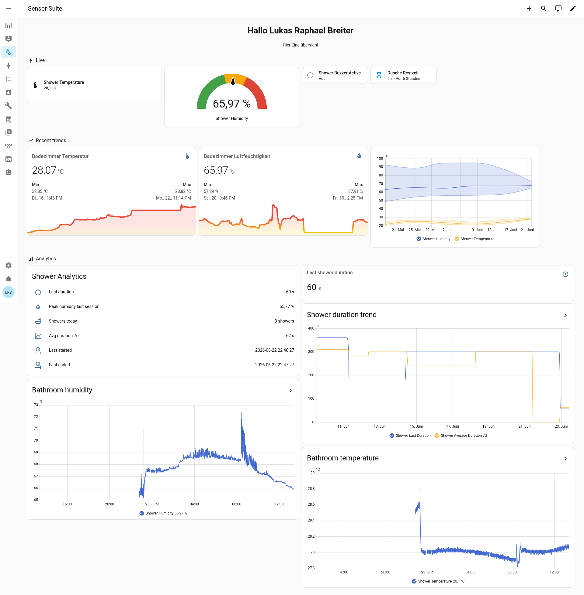

# ShowerTrack

End-to-end shower tracking. An embedded **collector** times showers and
publishes sensor/timer state over MQTT. A server-side **ingestor** subscribes to
those topics and writes telemetry, events and derived shower sessions into
PostgreSQL, while a **Home Assistant** instance subscribes to the same broker to
surface live values and analytics on a dashboard.

## Architecture — tiers, protocols and payloads

```text
┌────────────────────────────────────────────────────────────────────┐
│ TIER 1 · Collector (embedded)                                        │
│ Feather nRF52840 + AirLift + Grove sensors                           │
│ firmware: showertrack-circuitpython                                  │
└────────────────────────────────────────────────────────────────────┘
        │  protocol: MQTT publish over TCP
        │  topics:   shower/device1/{status, telemetry, event}
        │  payload:  status    → text  ("online"/"offline", retained + LWT)
        │            telemetry → JSON  (sensor + timer state, every 5 s)
        │            event     → JSON  (boot, timer_*, alarm_silenced, …)
        ▼
┌────────────────────────────────────────────────────────────────────┐
│ TIER 2 · Messaging                                                   │
│ MQTT broker (e.g. Mosquitto)                                         │
└────────────────────────────────────────────────────────────────────┘
        │  protocol: MQTT subscribe  shower/+/{status, telemetry, event}
        ├──────────────────────────────────────┐
        ▼                                       ▼
┌─────────────────────────────────┐  ┌───────────────────────────────────┐
│ TIER 3a · Ingestion             │  │ TIER 3b · Visualisation           │
│ mqtt_ingestor (paho-mqtt)       │  │ Home Assistant                    │
│ parse JSON → rows               │  │ MQTT sensors → dashboard          │
│ service: showertrack-mqtt_…     │  │ config: homeassistant_….yaml      │
└─────────────────────────────────┘  └───────────────────────────────────┘
        │  protocol: SQL over TCP (psycopg)
        │  payload:  INSERT / UPDATE rows
        ▼
┌─────────────────────────────────┐
│ TIER 4 · Storage                │
│ PostgreSQL 16                   │
│ telemetry_readings · device_events · shower_sessions
└─────────────────────────────────┘
```

Tiers 3a (ingestion) and 3b (visualisation) are independent MQTT subscribers
sharing the same broker: the ingestor persists history, Home Assistant renders
the live state. The exact topics and JSON payload shapes shared by all tiers are
documented under
[MQTT interface (shared contract)](#mqtt-interface-shared-contract).

## Repository layout

```text
.
├── showertrack-circuitpython/        # TIER 1 — device firmware (CircuitPython collector)
├── showertrack-mqtt_ingestor/        # TIER 3a — MQTT → PostgreSQL ingestor (Docker Compose)
├── homeassistant_configuration.yaml  # TIER 3b — Home Assistant MQTT sensors
└── dashboard.png                     # screenshot of the Home Assistant dashboard
```

---

# 1. Collector firmware — `showertrack-circuitpython/`

A CircuitPython data-collection firmware for the
**Adafruit Feather nRF52840 Express + AirLift FeatherWing** and a small stack
of Grove sensors. The device reads local sensor/timer state and publishes it
over MQTT

## Hardware

- Grove rotary angle sensor on `A0` (analog input).
- Grove button on `A2` (digital input, active HIGH).
- Grove buzzer on `A4` (PWM output).
- SHT4x humidity/temperature sensor on I2C (`SCL`/`SDA`).
- 4-digit TM1637 display on `TX`/`RX`.
- AirLift FeatherWing for Wi-Fi/MQTT (`CS=D13`, `BUSY/READY=D11`,
  `RESET=D12`, `GPIO0` not connected).

## Package layout

```text
showertrack-circuitpython/
├── boot.py                 # runs once at reset (minimal)
├── code.py                 # entry point: starts the app
├── secrets.example.py      # copy to secrets.py and fill in
├── requirements.txt        # CircuitPython library list (circup)
└── showertrack/            # application package
    ├── __init__.py
    ├── clock.py            # monotonic millisecond clock
    ├── config.py           # pins, topics, intervals, timer limits
    ├── display.py          # bit-banged TM1637 driver (port of FourDigitDisplay)
    ├── timer.py            # TimerState constants
    └── app.py              # setup()/loop() orchestrator + state machine
```

## Deployment

1. **Install CircuitPython** (9.x or newer) on the Feather nRF52840. Drag the
   `.uf2` from <https://circuitpython.org/board/feather_nrf52840_express/>
   onto the `FEATHERBOOT` drive; the board reappears as `CIRCUITPY`.

2. **Install the libraries.** With [circup](https://github.com/adafruit/circup):

   ```bash
   uv sync
   uv run circup install adafruit_esp32spi adafruit_minimqtt adafruit_sht4x \
                  adafruit_connection_manager adafruit_ticks adafruit_bus_device
   ```

   (The TM1637 display needs no library — it is bit-banged with `digitalio`.
   Make sure the bundle matches your CircuitPython major version.)

3. **Copy the project** onto the `CIRCUITPY` drive so the layout becomes:

   ```text
   CIRCUITPY/
   ├── boot.py
   ├── code.py
   ├── secrets.py
   ├── showertrack/          # the package
   └── lib/                  # the libraries from step 2
   ```

   On the nRF52840, run `sync` and safely eject the `CIRCUITPY` drive before
   resetting — its internal flash is prone to corruption if writes aren't
   flushed.

4. **Create `secrets.py`** from the template:

   ```bash
   cp secrets.example.py secrets.py     # then edit secrets.py
   ```

5. The board auto-runs `code.py` on reset. Open the USB serial console
   (115200 baud) to watch boot diagnostics.

If `secrets.py`, the radio libraries, or the AirLift itself are missing, the
device still boots and runs the timer/display/buzzer locally — it simply skips
Wi-Fi/MQTT.

## Usage

The rotary angle sensor selects a duration from 1 to 20 minutes in 30-second
steps. The button drives the timer:

- `idle` → start the timer.
- `running` → pause.
- `paused` → resume from the stored remaining time.
- `alarm` → silence the buzzer and return to `idle`.

When the timer hits zero the device enters `alarm`, publishes a
`timer_finished` event, and sounds the buzzer until the button is pressed.

---

# 2. Ingestor — `showertrack-mqtt_ingestor/`

A Dockerised service that subscribes to the device's MQTT topics and persists
everything into PostgreSQL. It stores raw telemetry and events, and derives
**shower sessions** from the timer's lifecycle events (start on
`timer_started`, close on `timer_finished`, with fallbacks for
`alarm_silenced` and stale open sessions).

## Stack

- Python 3.12, [`paho-mqtt`](https://pypi.org/project/paho-mqtt/) 2.x,
  [`psycopg`](https://www.psycopg.org/) 3.
- PostgreSQL 16.
- Docker Compose (two services: `postgres` and `mqtt_ingestor`).

## Layout

```text
showertrack-mqtt_ingestor/
├── docker-compose.yml          # postgres + mqtt_ingestor services
├── .env.example                # config template → copy to .env
├── initdb/                     # run by Postgres on first init (empty volume)
│   ├── 000_app_user.sh         # creates the app role from $APP_DB_PASSWORD
│   └── 001_schema.sql          # table definitions
├── schema_v2.sql               # current schema matching the ingestor
└── mqtt_ingestor/
    ├── app.py                  # subscribe → parse → write to Postgres
    ├── Dockerfile
    └── requirements.txt
```

## Configuration

All configuration — broker, database and credentials — comes from a `.env`
file that Docker Compose substitutes into `docker-compose.yml`. Nothing
sensitive lives in a committed file.

```bash
cd showertrack-mqtt_ingestor
cp .env.example .env     # then edit .env with real values
```

| Variable | Purpose |
| --- | --- |
| `POSTGRES_USER` / `POSTGRES_PASSWORD` / `POSTGRES_DB` | Postgres superuser + database created on first init. |
| `TZ` | Container timezone. |
| `APP_DB_PASSWORD` | Password for the `showertrack_app` role the ingestor connects as. |
| `MQTT_HOST` / `MQTT_PORT` / `MQTT_USERNAME` / `MQTT_PASSWORD` | Broker connection. |
| `MQTT_TOPIC_TELEMETRY` / `_EVENT` / `_STATUS` | Topic filters (`+` wildcard supplies `device_id`). |
| `PGHOST` / `PGPORT` / `PGDATABASE` / `PGUSER` | Where and as whom the ingestor connects. |

## Running

```bash
cd showertrack-mqtt_ingestor
docker compose up -d --build
docker compose logs -f mqtt_ingestor
```

On the **first** start (empty data volume) Postgres runs everything in
`initdb/` — `000_app_user.sh` creates the `showertrack_app` role from
`APP_DB_PASSWORD`, then `001_schema.sql` creates the tables. The Postgres data
directory is bind-mounted at `/mnt/ssd/showertrack/postgres`; init scripts do
**not** re-run while that volume already contains a database.

## Database schema

The ingestor writes to three tables (see `schema_v2.sql`):

- `telemetry_readings` — one row per telemetry message (every 5 s).
- `device_events` — `boot`, `timer_started/paused/resumed/finished`,
  `alarm_silenced`, `mqtt_reconnected`, and `online`/`offline` status.
- `shower_sessions` — derived sessions with start/end, duration, timer target
  and overrun, humidity stats, detection method and confidence.

---

# 3. Dashboard — Home Assistant

The visualisation tier is a [Home Assistant](https://www.home-assistant.io/)
instance that subscribes to the **same MQTT broker** as the ingestor. It needs
no custom code — only declarative MQTT sensor definitions that map fields out of
the telemetry payload onto entities, which are then arranged on a dashboard.



The dashboard shows live values (shower temperature, humidity, buzzer state,
remaining time), recent humidity/temperature trends, and derived shower
analytics (last/average duration, showers today, duration trend).

## Configuration

`homeassistant_configuration.yaml` defines the entities. Each one reads from
`shower/device1/telemetry` with a `value_template` that picks a single JSON
field, and uses `shower/device1/status` as its availability topic so entities
show as *unavailable* when the device goes offline:

| Entity | Type | Source field |
| --- | --- | --- |
| Shower Temperature | `sensor` (°C) | `temperature_c` |
| Shower Humidity | `sensor` (%) | `humidity_rh` |
| Shower Remaining Seconds | `sensor` (s) | `remaining_s` |
| Shower Buzzer Active | `binary_sensor` | `buzzer_active` |

To use it, merge the contents into your Home Assistant `configuration.yaml` (or
include the file), point the `mqtt:` integration at the same broker the firmware
publishes to, and restart Home Assistant. The historic charts and analytics are
built on top of these entities using Home Assistant's recorder/history and
standard dashboard cards.

---

## MQTT interface (shared contract)

Topics published by the firmware and consumed by both the ingestor and
Home Assistant:

- `shower/device1/status` — `online` (retained) / `offline` (MQTT last will).
- `shower/device1/telemetry` — published every 5 s while connected.
- `shower/device1/event` — `boot`, `mqtt_reconnected`, `timer_started`,
  `timer_paused`, `timer_resumed`, `timer_finished`, `alarm_silenced`.

Telemetry payload:

```json
{
  "uptime_ms": 123456,
  "state": "running",
  "wifi_connected": true,
  "mqtt_connected": true,
  "temperature_c": 24.81,
  "humidity_rh": 71.20,
  "rotary_raw": 512,
  "selected_duration_s": 600,
  "run_duration_s": 600,
  "remaining_s": 485,
  "buzzer_active": false
}
```

`temperature_c` and `humidity_rh` are `null` when the SHT4x is unavailable or a
read fails. The device publishes no wall-clock time; the ingestor records its
own receive timestamp.
